## Sobre mim

Trabalho com **Fluig**, **automação de processos** e **integrações**. Meu foco atual é publicar formulários e templates (**FreeMarker**) de forma automática com **GitHub Actions**, trocando rotinas manuais por fluxos que rodam sozinhos.

## Tecnologias

  
  
  
  
  
  
  
  

## Destaques

  

## Jogue comigo: Deploy de Sexta

Uma mini-aventura jogável aqui mesmo, só com cliques. Escolha uma opção para avançar. Errou? Feche a opção e tente outra.

<b>▶️ Começar a missão</b>

<blockquote>

🕔 <b>Sexta-feira, 16h50.</b> O formulário novo do Fluig está pronto e o chefe quer em produção ainda hoje. O que você faz?

🚀 Publicar direto em produção

<blockquote>💥 <b>Fim de jogo.</b> O formulário subiu com um campo obrigatório quebrado e o processo de compras parou. Seu fim de semana também. Feche esta opção e tente outra.</blockquote>

🔍 Rodar a auditoria antes

<blockquote>

✅ Boa. A auditoria terminou e apontou <b>1 erro e 3 avisos</b>. E agora?

🛠️ Corrigir o erro e ler os avisos

<blockquote>

✅ Tudo verde em 10 minutos. <b>Onde você publica primeiro?</b>

🏭 Em produção, estou confiante

<blockquote>💥 <b>Fim de jogo.</b> Funcionava na sua máquina. Em produção, o dataset tinha outro nome. Feche esta opção e tente outra.</blockquote>

🤫 No servidor do colega, sem avisar

<blockquote>💥 <b>Fim de jogo.</b> Ele estava no meio de uma demonstração para o cliente. Vocês não se falam mais. Feche esta opção e tente outra.</blockquote>

🧪 Em homologação, com dry-run

<blockquote>

✅ Sábio. Mas o <code>dry-run</code> listou <b>12 formulários</b>, e você só alterou 1. O que faz?

📦 Publicar os 12, vai que precisa

<blockquote>💥 <b>Fim de jogo.</b> Onze deles eram rascunhos de outro time. Agora são rascunhos em uso. Feche esta opção e tente outra.</blockquote>

🕵️ Investigar por que são 12

<blockquote>

✅ O filtro estava vazio e pegava tudo. Você corrige, publica só o seu e a homologação passa. <b>Falta a produção, e o pipeline pede uma aprovação.</b>

🤝 Pedir para um colega revisar e aprovar

<blockquote>🏆 <b>Missão cumprida!</b> Deploy em produção às 17h28, zero chamados abertos. Você audita, testa em homologação e pede revisão: pode trabalhar comigo. Bom fim de semana!</blockquote>

🔑 Aprovar você mesmo, com a conta do chefe

<blockquote>💥 <b>Fim de jogo.</b> O deploy passou, a auditoria de acessos também passou... na segunda-feira, pela sua mesa. Feche esta opção e tente outra.</blockquote>

💪 <code>git push --force</code> e seja o que Deus quiser

<blockquote>💥 <b>Fim de jogo.</b> Você sobrescreveu o trabalho de três pessoas a 2 minutos do fim do expediente. Feche esta opção e tente outra.</blockquote>

</blockquote>

💻 Fechar o notebook bem devagar

<blockquote>💥 <b>Fim de jogo.</b> O problema continuou lá, e na segunda-feira ele tinha crescido. Feche esta opção e tente outra.</blockquote>

</blockquote>

</blockquote>

🙈 Ignorar, é só aviso

<blockquote>💥 <b>Fim de jogo.</b> O "só aviso" era o erro. O formulário salvou todos os pedidos com valor zero. Feche esta opção e tente outra.</blockquote>

🔇 Desligar a auditoria

<blockquote>💥 <b>Fim de jogo.</b> Sem alarme não há incêndio, certo? Errado. Feche esta opção e tente outra.</blockquote>

</blockquote>

🛋️ Deixar para segunda-feira

<blockquote>😴 <b>Final alternativo.</b> Ninguém quebra produção numa sexta se não publicar na sexta. Só que o chefe pediu para hoje. Feche esta opção e tente outra.</blockquote>

</blockquote>

## Atividade no GitHub

  
  

  <picture>
    <source media="(prefers-color-scheme: dark)" srcset="https://raw.githubusercontent.com/luizcristo-cyber/luizcristo-cyber/main/profile/github-snake-dark.svg" />
    
  </picture>

