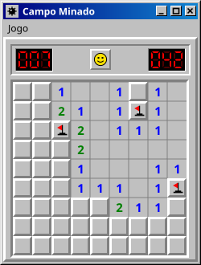

## Sobre mim

Trabalho com **Fluig**, **automação de processos** e **integrações**. Meu foco atual é publicar formulários e templates (**FreeMarker**) de forma automática com **GitHub Actions**, trocando rotinas manuais por fluxos que rodam sozinhos.

## Tecnologias

  
  
  
  
  
  
  
  

## Destaques

  

## Jogue comigo: Campo Minado

  

  O campo minado clássico, completo: três níveis, bandeiras, cronômetro e recordes. Acertou uma mina, acabou.

  

## Atividade no GitHub

  
  

  <picture>
    <source media="(prefers-color-scheme: dark)" srcset="https://raw.githubusercontent.com/luizcristo-cyber/luizcristo-cyber/main/profile/github-snake-dark.svg" />
    
  </picture>

